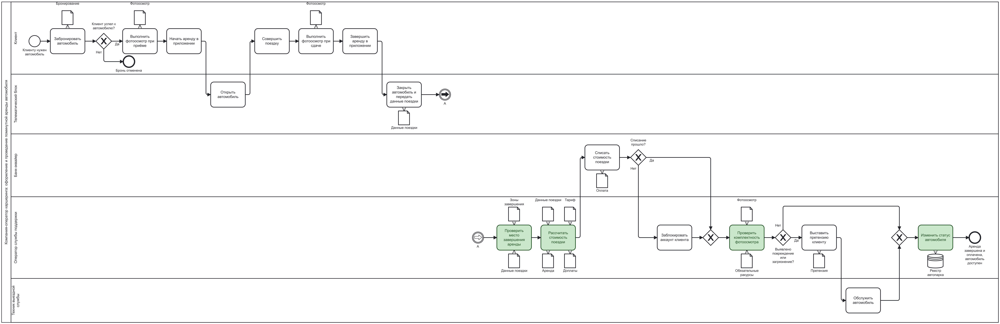
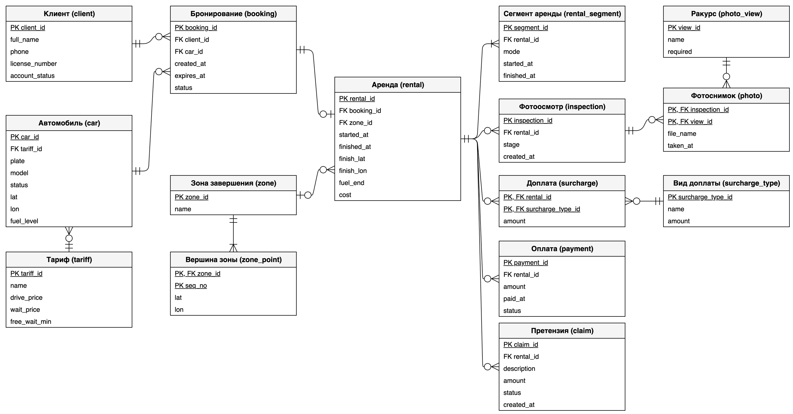
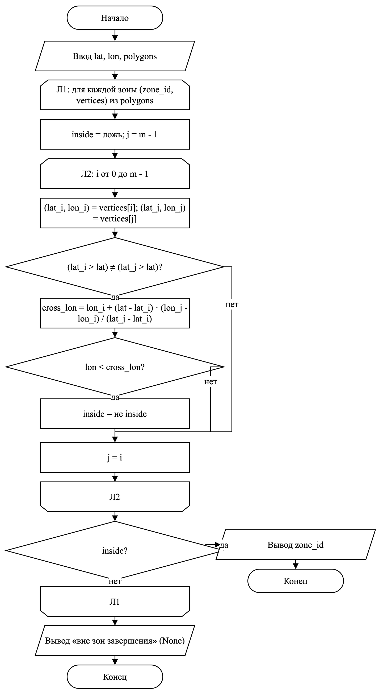
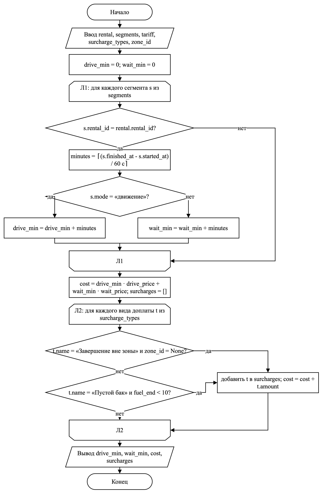

# 2 Аналитический раздел

## 2.1 Модель бизнес-процесса

Процесс «Оформление и проведение поминутной аренды автомобиля», описанный в подразделе 1.2, смоделирован в нотации BPMN 2.0. Нотация определена спецификацией Object Management Group [19]: процесс в ней строится из объектов потока (событий, задач и шлюзов), объектов данных, соединяющих объектов и пулов с дорожками. Соколова М. Д. и Карамышев А. Н. отмечают, что события показывают начало, завершение или изменение состояния процесса, шлюзы - точки выбора и объединения ветвей, а пулы и дорожки распределяют действия и зоны ответственности между участниками [20]. Поэтому BPMN подходит для процесса, в котором действия передаются между клиентом, сотрудниками оператора, телематическим блоком и банком.

Модель представлена на рисунке 1. Пул «Компания-оператор каршеринга» разделён на пять дорожек по участникам из таблицы 1: клиент, телематический блок, банк-эквайер, оператор службы поддержки и техник выездной службы. Каждая задача стоит в дорожке того, кто её выполняет в текущем процессе. Диаграмма содержит 16 задач, поэтому подпроцессы не выделялись; для размещения на двух листах она разделена парой связующих событий «А».




Процесс начинается с начального события «Клиенту нужен автомобиль» и заканчивается конечным событием «Аренда завершена и оплачена, автомобиль доступен» - тем же результатом, что указан в подразделе 1.2. Ветвления показаны исключающими шлюзами с подписанными выходами:

- «Клиент успел к автомобилю?»: если клиент не открыл автомобиль за время брони, процесс завершается событием «Бронь отменена»;
- «Списание прошло?»: при неудачном списании оператор блокирует аккаунт клиента;
- «Выявлено повреждение или загрязнение?»: при положительном ответе оператор выставляет претензию, а техник обслуживает автомобиль.

Документы и данные, которые передаются между шагами, показаны объектами данных: «Бронирование», «Фотоосмотр», «Данные поездки», «Зоны завершения», «Тариф», «Аренда», «Доплаты», «Оплата», «Обязательные ракурсы», «Претензия» и хранилище «Реестр автопарка». Из них в подразделе 2.2 выведены сущности логической модели.

Задачи, выделенные на диаграмме зелёным цветом, программа возьмёт на себя. Каждая из них закрывает узкое место из подраздела 1.2: проверка фотоосмотра - первое и второе, проверка места завершения и расчёт стоимости - третье, изменение статуса автомобиля - четвёртое и пятое. Автоматизируемые операции перечислены в таблице 2.

Таблица 2 - Автоматизируемые операции

| № | Операция (задача на диаграмме)      | Кто выполняет сейчас                                  | Что будет делать система                                                                                       | Функция в коде      |
|---|-------------------------------------|-------------------------------------------------------|----------------------------------------------------------------------------------------------------------------|---------------------|
| 1 | Проверить комплектность фотоосмотра | Оператор службы поддержки вручную, после поездки      | Сверяет снимки фотоосмотра с перечнем обязательных ракурсов и сообщает, каких не хватает                       | check_inspection()  |
| 2 | Проверить место завершения аренды   | Оператор службы поддержки вручную по карте            | Определяет зону завершения, в которую попала точка завершения аренды, или сообщает, что точка вне всех зон     | check_finish_zone() |
| 3 | Рассчитать стоимость поездки        | Оператор службы поддержки вручную по таблицам тарифов | Суммирует минуты движения и ожидания по ставкам тарифа и начисляет доплаты за завершение вне зоны и пустой бак | calc_trip_cost()    |
| 4 | Изменить статус автомобиля          | Оператор службы поддержки вручную в реестре автопарка | Проверяет, допустим ли переход между статусами, и меняет статус автомобиля                                     | set_car_status()    |

## 2.2 Логическая модель данных

Сущности логической модели выведены из объектов данных и участников процесса на рисунке 1. Участник «Клиент» стал сущностью «Клиент», хранилище «Реестр автопарка» - сущностью «Автомобиль», объект «Зоны завершения» - сущностями «Зона завершения» и «Вершина зоны», «Данные поездки» - «Сегмент аренды», «Фотоосмотр» и «Обязательные ракурсы» - сущностями «Фотоосмотр», «Ракурс» и «Фотоснимок», «Доплаты» - сущностями «Вид доплаты» и «Доплата». Объекты «Бронирование», «Аренда», «Тариф», «Оплата» и «Претензия» перешли в одноимённые сущности.

Модель построена в нотации «вороньи лапки» (crow's foot) и не привязана к конкретной СУБД: типы столбцов, индексы и SQL (Structured Query Language) относятся к физической модели. Модель представлена на рисунке 2. Участники, объекты и справочники описаны в таблице 3, документы процесса - в таблице 4, связи - в таблице 5. Первичный ключ обозначен PK, внешний ключ - FK.



Таблица 3 - Сущности: участники, объекты и справочники

| Сущность                     | Назначение                                                          | Атрибуты                                         | PK                | FK        |
|------------------------------|---------------------------------------------------------------------|--------------------------------------------------|-------------------|-----------|
| Клиент (client)              | Верифицированный клиент, который арендует автомобиль                | full_name, phone, license_number, account_status | client_id         | нет       |
| Тариф (tariff)               | Ставки за минуту движения и минуту ожидания, бесплатное время брони | name, drive_price, wait_price, free_wait_min     | tariff_id         | нет       |
| Автомобиль (car)             | Автомобиль автопарка и его текущее состояние                        | plate, model, status, lat, lon, fuel_level       | car_id            | tariff_id |
| Зона завершения (zone)       | Территория, где можно завершить аренду без доплаты                  | name                                             | zone_id           | нет       |
| Вершина зоны (zone_point)    | Точка границы зоны в порядке обхода                                 | lat, lon                                         | zone_id, seq_no   | zone_id   |
| Ракурс (photo_view)          | Ракурс фотоосмотра и признак обязательности                         | name, required                                   | view_id           | нет       |
| Вид доплаты (surcharge_type) | Вид доплаты и её текущий размер                                     | name, amount                                     | surcharge_type_id | нет       |

Таблица 4 - Сущности: документы процесса

| Сущность                        | Назначение                                                       | Атрибуты                                                        | PK                           | FK                           |
|---------------------------------|------------------------------------------------------------------|-----------------------------------------------------------------|------------------------------|------------------------------|
| Бронирование (booking)          | Закрепление автомобиля за клиентом на время бесплатного ожидания | created_at, expires_at, status                                  | booking_id                   | client_id, car_id            |
| Аренда (rental)                 | Поездка от начала до завершения и её итоговая стоимость          | started_at, finished_at, finish_lat, finish_lon, fuel_end, cost | rental_id                    | booking_id, zone_id          |
| Сегмент аренды (rental_segment) | Непрерывный отрезок аренды в одном режиме: движение или ожидание | mode, started_at, finished_at                                   | segment_id                   | rental_id                    |
| Фотоосмотр (inspection)         | Фотоосмотр при приёме или при сдаче автомобиля                   | stage, created_at                                               | inspection_id                | rental_id                    |
| Фотоснимок (photo)              | Снимок одного ракурса в фотоосмотре                              | file_name, taken_at                                             | inspection_id, view_id       | inspection_id, view_id       |
| Доплата (surcharge)             | Доплата, начисленная за аренду                                   | amount                                                          | rental_id, surcharge_type_id | rental_id, surcharge_type_id |
| Оплата (payment)                | Попытка списания стоимости с карты клиента                       | amount, paid_at, status                                         | payment_id                   | rental_id                    |
| Претензия (claim)               | Претензия клиенту за повреждение или загрязнение                 | description, amount, status, created_at                         | claim_id                     | rental_id                    |

Таблица 5 - Связи между сущностями

| Родительская сущность | Дочерняя сущность | Мощность | Смысл связи                                                                 |
|-----------------------|-------------------|----------|-----------------------------------------------------------------------------|
| Тариф                 | Автомобиль        | 1:N      | По одному тарифу работает много автомобилей, у автомобиля один тариф        |
| Клиент                | Бронирование      | 1:N      | Клиент может сделать много бронирований, каждое принадлежит одному клиенту  |
| Автомобиль            | Бронирование      | 1:N      | Автомобиль бронируют много раз, каждая бронь относится к одному автомобилю  |
| Бронирование          | Аренда            | 1:1      | Бронь переходит не более чем в одну аренду, аренда начинается с одной брони |
| Зона завершения       | Вершина зоны      | 1:N      | Граница зоны состоит из нескольких вершин                                   |
| Зона завершения       | Аренда            | 1:N      | В зоне завершается много аренд; аренда, завершённая вне зон, зоны не имеет  |
| Аренда                | Сегмент аренды    | 1:N      | Поездка делится на отрезки движения и ожидания                              |
| Аренда                | Фотоосмотр        | 1:N      | У аренды фотоосмотр при приёме и при сдаче                                  |
| Фотоосмотр            | Фотоснимок        | 1:N      | Фотоосмотр состоит из снимков разных ракурсов                               |
| Ракурс                | Фотоснимок        | 1:N      | Один ракурс снимают во многих фотоосмотрах                                  |
| Аренда                | Доплата           | 1:N      | За одну аренду начисляется несколько доплат                                 |
| Вид доплаты           | Доплата           | 1:N      | Один вид доплаты начисляется во многих арендах                              |
| Аренда                | Оплата            | 1:N      | Стоимость аренды списывается одной или несколькими попытками                |
| Аренда                | Претензия         | 1:N      | По аренде может быть выставлено несколько претензий                         |

В модели две связи многие-ко-многим, и обе разрешены ассоциативными сущностями со своими атрибутами. Фотоосмотр и ракурс связаны через сущность «Фотоснимок»: в одном фотоосмотре несколько ракурсов, один ракурс снимают во многих фотоосмотрах, а файл и время съёмки относятся к их паре. Аренда и вид доплаты связаны через сущность «Доплата», которая хранит начисленную сумму. Сущность «Бронирование» так же разрешает связь многие-ко-многим между клиентом и автомобилем.

Модель приведена к третьей нормальной форме. Буренок Д. С. и Воеводин В. А. формулируют требования нормальных форм так: в первой нормальной форме на пересечении строк и столбцов хранятся скалярные значения, во второй каждый неключевой столбец зависит от первичного ключа, в третьей неключевые столбцы зависят только от первичного ключа и транзитивных зависимостей нет; нормализация устраняет аномалии данных [21].

Первая нормальная форма выполняется: каждый атрибут хранит одно значение. Граница зоны завершения - это список точек, поэтому она вынесена в сущность «Вершина зоны»: каждая точка хранится в ней отдельной записью с порядковым номером, а не в списке координат в одном поле зоны.

Вторая нормальная форма выполняется: у сущностей с составным ключом («Вершина зоны», «Фотоснимок», «Доплата») неключевые атрибуты зависят от ключа целиком. Название ракурса зависит только от `view_id`, поэтому оно хранится в сущности «Ракурс», а не в каждом фотоснимке.

Третья нормальная форма выполняется: транзитивных зависимостей нет. Аренда не хранит клиента и автомобиль, потому что они определяются через бронирование: `rental_id` определяет `booking_id`, а `booking_id` определяет `client_id` и `car_id`. Без нормализации здесь возникло бы дублирование: если хранить ставки тарифа в каждом автомобиле, ставки «Эконома» повторялись бы в записях всех автомобилей этого тарифа, и при изменении цены пришлось бы обновлять каждую запись, рискуя оставить часть автомобилей со старой ценой. Разбиение на сущности «Тариф» и «Автомобиль» хранит ставки один раз, а автомобиль ссылается на тариф по `tariff_id`. Стоимость аренды `cost` и сумма доплаты `amount` не нарушают третью нормальную форму: это суммы, зафиксированные в момент расчёта, и они не должны меняться вслед за последующим изменением тарифа.

## 2.3 Алгоритмы

Для двух автоматизируемых операций из таблицы 2 разработаны алгоритмы: проверка места завершения аренды и расчёт стоимости поездки. Остальные операции сводятся к сравнению множеств и проверке допустимого перехода и описаны в подразделе 2.4. Схемы алгоритмов выполнены по ГОСТ 19.701-90 [22]: решения показаны ромбами с выходами «да» и «нет», ввод и вывод - параллелограммами, циклы - парами символов границы цикла с общим именем.

Вычислительная сложность оценивается асимптотически, то есть по порядку роста времени выполнения в зависимости от объёма входных данных; запись t(n) = O(f(n)) означает, что начиная с некоторого n время работы не превышает C·f(n) [23]. Оценки даны для худшего случая по времени.

### 2.3.1 Алгоритм проверки места завершения аренды

Алгоритм определяет, в какую зону завершения попала точка, где клиент закончил аренду. Каждая зона задана многоугольником из своих вершин. Для точки применяется метод луча: из неё мысленно проводится луч на восток, и считается, сколько сторон многоугольника он пересекает. При нечётном числе пересечений точка внутри многоугольника. Метод верно работает и для невыпуклых зон, например для зоны у аэропорта с вырезом.

Входные данные: координаты точки `lat`, `lon` и список зон `polygons`, где каждая зона - пара из идентификатора и списка вершин. Результат: идентификатор зоны или пустое значение `None`, если точка вне всех зон; в этом случае при расчёте стоимости начисляется доплата за завершение вне зоны.

Схема алгоритма представлена на рисунке 3, его реализация - в листинге 1.



Листинг 1 - Функция проверки места завершения аренды

```python
def check_finish_zone(lat: float, lon: float, polygons: list[Polygon]) -> int | None:
    for zone_id, vertices in polygons:
        inside = False
        j = len(vertices) - 1
        for i in range(len(vertices)):
            lat_i, lon_i = vertices[i]
            lat_j, lon_j = vertices[j]
            if (lat_i > lat) != (lat_j > lat):
                cross_lon = lon_i + (lat - lat_i) * (lon_j - lon_i) / (lat_j - lat_i)
                if lon < cross_lon:
                    inside = not inside
            j = i
        if inside:
            return zone_id
    return None
```

Первое условие отбирает стороны, концы которых лежат по разные стороны от широты точки. Горизонтальные стороны им отсекаются, поэтому деления на ноль при вычислении `cross_lon` не возникает. Второе условие проверяет, что пересечение луча со стороной лежит восточнее точки.

Оценка сложности. Пусть n - число зон завершения, m - наибольшее число вершин зоны. Внешний цикл Л1 выполняется не более n раз, по одному разу на зону. Внутренний цикл Л2 для каждой зоны выполняется столько раз, сколько у неё вершин, то есть не более m раз. Тело внутреннего цикла содержит два сравнения, одно вычисление по формуле и присваивания, то есть выполняется за O(1). Худший случай - точка вне всех зон или в последней зоне списка: тогда оба цикла проходят полностью, и время работы составляет O(n·m). Если точка лежит в первой зоне, алгоритм завершается после её проверки за O(m). Подготовка списка вершин каждой зоны в порядке обхода выполняется один раз при загрузке данных, а не при каждом завершении аренды, и в оценку не входит. Память: O(1), кроме входных данных используются только переменные `inside`, `j` и `cross_lon`.

### 2.3.2 Алгоритм расчёта стоимости поездки

Алгоритм суммирует время аренды по режимам и начисляет доплаты. Длительность каждого сегмента округляется вверх до целых минут, минуты движения и ожидания умножаются на ставки тарифа. Затем перебираются виды доплат: доплата за завершение вне зоны начисляется, если алгоритм проверки места завершения вернул `None`, доплата за пустой бак - если при завершении в баке меньше 10 % топлива. Денежные суммы считаются в десятичной арифметике (тип `Decimal`), чтобы не накапливать ошибку округления двоичных дробей.

Входные данные: аренда `rental`, список сегментов `segments`, тариф автомобиля `tariff`, список видов доплат `surcharge_types` и результат проверки места завершения `zone_id`. Результат: минуты движения и ожидания, итоговая стоимость и список начисленных доплат.

Схема алгоритма представлена на рисунке 4, его реализация - в листинге 2.



Листинг 2 - Тело функции `calc_trip_cost` расчёта стоимости поездки

```python
drive_min = 0
wait_min = 0
for s in segments:
    if s["rental_id"] != rental["rental_id"]:
        continue
    duration = datetime.fromisoformat(s["finished_at"]) - datetime.fromisoformat(
        s["started_at"],
    )
    minutes = math.ceil(duration.total_seconds() / 60)
    if s["mode"] == "движение":
        drive_min += minutes
    else:
        wait_min += minutes
cost = drive_min * Decimal(tariff["drive_price"]) + wait_min * Decimal(
    tariff["wait_price"],
)
surcharges = []
for t in surcharge_types:
    if (t["name"] == OUTSIDE_ZONE and zone_id is None) or (
        t["name"] == LOW_FUEL and rental["fuel_end"] < LOW_FUEL_PERCENT
    ):
        surcharges.append(
            {
                "rental_id": rental["rental_id"],
                "surcharge_type_id": t["surcharge_type_id"],
                "amount": t["amount"],
            },
        )
        cost += Decimal(t["amount"])
```

Оценка сложности. Пусть s - число сегментов в списке `segments`, k - число видов доплат. Цикл Л1 выполняется ровно s раз: каждый сегмент проверяется на принадлежность аренде. Тело цикла выполняется за O(1): разбор двух меток времени фиксированной длины, вычитание, округление и одно сравнение. Цикл Л2 выполняется ровно k раз, его тело - сравнение коротких строк и добавление в конец списка за O(1). Циклы идут последовательно, а не вложенно, поэтому время работы составляет O(s + k) в любом случае. Справочник видов доплат мал и от числа поездок не зависит, поэтому на практике время работы линейно по числу сегментов, O(s). Память: O(k) на список начисленных доплат.

Таким образом, алгоритмы имеют разную сложность: проверка места завершения - O(n·m) за счёт вложенного цикла по зонам и их вершинам, расчёт стоимости - O(s + k) за счёт двух последовательных циклов.

## 2.4 Процедурная реализация

Алгоритмы и операции из таблицы 2 реализованы на языке Python 3.14 в процедурном стиле: программа состоит только из функций, а данные хранятся в стандартных структурах. Сущность логической модели представлена словарём `dict` с теми же атрибутами, набор сущностей - списком `list`. Классы, в том числе `dataclass`, `NamedTuple` и `Enum`, не используются, глобальных изменяемых переменных нет: функции получают данные через параметры и возвращают результат. Допустимые переходы статусов автомобиля заданы неизменяемым множеством `frozenset`.

Код находится в каталоге `src` репозитория:

- `operations.py` - функции автоматизируемых операций: `check_inspection()`, `check_finish_zone()`, `calc_trip_cost()`, `set_car_status()`, а также `zone_polygons()`, которая собирает вершины каждой зоны в порядке обхода;
- `main.py` - загрузка данных и сценарий завершения аренды с выводом результата в консоль;
- `data.json` - тестовые данные, по одному списку на каждую сущность логической модели;
- `test_operations.py` - автоматические проверки операций;
- `README.md` - инструкция по запуску.

Функция `check_inspection()` строит множество ракурсов, снятых в фотоосмотре, и возвращает обязательные ракурсы, которых в нём нет; поиск во множестве выполняется в среднем за O(1), поэтому вся проверка занимает O(p + r), где p - число снимков, r - число ракурсов. Функция `set_car_status()` проверяет, что пара «текущий статус - новый статус» входит в множество допустимых переходов, и возвращает новую запись автомобиля, не изменяя исходную.

Программа запускается из каталога `src` командой `python main.py` и для каждой аренды из `data.json` выполняет операции в порядке задач на рисунке 1: проверяет комплектность фотоосмотра при сдаче, определяет зону завершения, рассчитывает стоимость с доплатами и меняет статус автомобиля. Если фотоосмотр неполный или в баке меньше 10 % топлива, автомобиль переводится в статус «на обслуживании», иначе - в статус «свободен». Результат работы программы на тестовых данных приведён в листинге 3.

Листинг 3 - Результат работы программы на тестовых данных

```text
Аренда 1: Иванов Пётр Сергеевич, Kia Rio А123ВС777, тариф «Эконом»
  Фотоосмотр при сдаче: полный
  Место завершения: зона «Центр»
  Движение: 39 мин x 11.90 руб.
  Ожидание: 8 мин x 4.50 руб.
  Стоимость поездки: 500.10 руб.
  Статус автомобиля: в аренде -> свободен
Аренда 2: Смирнова Анна Олеговна, Hyundai Solaris В456ЕК799, тариф «Эконом»
  Фотоосмотр при сдаче: не хватает: Сзади, Салон
  Место завершения: вне зон завершения
  Движение: 43 мин x 11.90 руб.
  Ожидание: 0 мин x 4.50 руб.
  Доплата «Завершение вне зоны»: 300.00 руб.
  Доплата «Пустой бак»: 500.00 руб.
  Стоимость поездки: 1311.70 руб.
  Статус автомобиля: в аренде -> на обслуживании
Аренда 3: Ким Денис Андреевич, Skoda Octavia Е789КМ797, тариф «Комфорт»
  Фотоосмотр при сдаче: полный
  Место завершения: зона «Шереметьево»
  Движение: 39 мин x 15.50 руб.
  Ожидание: 18 мин x 5.90 руб.
  Стоимость поездки: 710.70 руб.
  Статус автомобиля: в аренде -> свободен
```

Три аренды в тестовых данных проходят разные ветви алгоритмов. Первая завершена в прямоугольной зоне «Центр» без доплат. Вторая завершена вне зон с почти пустым баком и неполным фотоосмотром, поэтому начислены обе доплаты, а автомобиль отправлен на обслуживание. Третья завершена в невыпуклой зоне «Шереметьево», и в её стоимость входят 18 минут ожидания по ставке тарифа «Комфорт».
