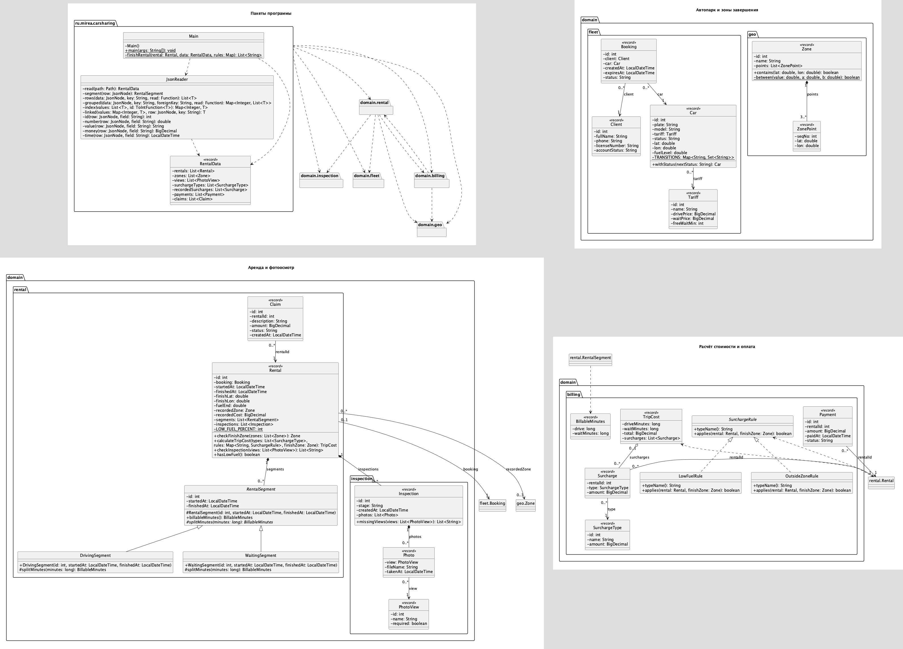

# 3 Реализация на Джаве и организационный раздел

## 3.1 Диаграмма классов

Для операций завершения аренды применено объектно-ориентированное программирование (ООП). В основу структуры классов легли логическая модель из подраздела 2.2 и операции из таблицы 2. На рисунке 5 схема пакетов и три листа с классами предметной области, выполненные в нотации UML 2.5.1 [24]. На диаграмме указаны поля и явно объявленные методы. Подписи конструкторов и методов чтения компонентов, которые компилятор Java создаёт для классов-записей (record), опущены [25].

Сущностям логической модели соответствуют классы `Client`, `Tariff`, `Car`, `Zone`, `ZonePoint`, `PhotoView`, `SurchargeType`, `Booking`, `Rental`, `RentalSegment`, `Inspection`, `Photo`, `Surcharge`, `Payment` и `Claim`. Вершины образуют границу зоны, снимки входят в фотоосмотр. Обе связи показаны как композиции. Тариф и клиент существуют независимо от отдельной поездки, поэтому связь тарифа с автомобилем и клиента с бронированием показана ассоциациями. В оплате, претензии и начисленной доплате идентификатор `rentalId` указывает на аренду. Программа читает оплаты и претензии при их наличии в файле. Действия банка и разбор претензии выходят за рамки прототипа.

Сущности «Сегмент аренды» соответствует абстрактный класс `RentalSegment` с общими полями. Его наследники `DrivingSegment` и `WaitingSegment` относят округлённую длительность к минутам движения и ожидания соответственно. Условия начисления доплат задаются через интерфейс `SurchargeRule`. Правило `OutsideZoneRule` проверяет результат поиска зоны по координатам завершения, `LowFuelRule` проверяет остаток топлива. В `TripCost` хранятся минуты движения и ожидания, итоговая сумма и начисленные доплаты.




## 3.2 Объектно-ориентированная реализация

Для сборки использованы JDK (Java Development Kit) 25 и Maven 3.9.9. Программа читает JSON библиотекой Jackson и создаёт объекты 15 сущностей. Для поиска по ключу справочники хранятся в `Map`. Сегменты группируются по аренде, вершины каждой зоны сортируются по порядковому номеру. Для каждой аренды программа выполняет четыре операции из таблицы 2 в порядке задач на рисунке 1.

Метод `Rental.checkFinishZone()` перебирает зоны в порядке файла. Для каждой зоны `Zone.contains()` применяет метод луча из подраздела 2.3.1 и сразу возвращает положительный результат, если точка попала на ребро. Когда точка входит в несколько зон, программа выбирает первую. В худшем случае приходится проверить рёбра всех зон. При `n` зонах и не более `m` рёбер в каждой верхняя оценка времени составляет O(n×m).

Метод `Rental.calculateTripCost()` обрабатывает сегменты по очереди из `List<RentalSegment>`. Длительность каждого сегмента округляется в `RentalSegment.billableMinutes()`. В листинге 4 показано, как два наследника относят округлённые минуты к движению или ожиданию. В расчёте вызов идёт через родительский тип.

Листинг 4 - Распределение минут в двух видах сегментов

```java
protected BillableMinutes splitMinutes(long minutes) {
    return new BillableMinutes(minutes, 0);
}

protected BillableMinutes splitMinutes(long minutes) {
    return new BillableMinutes(0, minutes);
}
```

Для денежных сумм используется `BigDecimal`. Цикл в листинге 5 перебирает виды доплат в порядке входного файла, ищет правило по названию и проверяет условие через `SurchargeRule`. При `s` сегментах выбранной аренды и `k` видах доплат расчёт занимает O(s + k), если поиск правила по ключу занимает O(1). Сегменты группируются при чтении файла, поэтому при расчёте не приходится просматривать сегменты остальных поездок.

Листинг 5 - Начисление доплат по правилам

```java
List<Surcharge> surcharges = new ArrayList<>();
for (var type : types) {
    var rule = rules.get(type.name());
    if (rule != null && rule.applies(this, finishZone)) {
        surcharges.add(new Surcharge(id, type, type.amount()));
        total = total.add(type.amount());
    }
}
```

Метод `Rental.checkInspection()` выбирает фотоосмотр при сдаче. `Inspection.missingViews()` собирает в `Set` идентификаторы ракурсов на снимках и возвращает список обязательных ракурсов, которых в этом множестве нет. Если фотоосмотра при сдаче нет, недостающими считаются все обязательные ракурсы. Метод `Car.withStatus()` проверяет допустимость перехода и возвращает автомобиль с выбранным статусом. Результат поездки остаётся в памяти, исходный JSON сохраняется без изменений.

## 3.3 Сопоставление процедурной и объектно-ориентированной реализаций

В таблице 6 сопоставлены хранение данных, четыре операции КТ2 и обработка ошибок в Python и Java. Для двух алгоритмов выделены отдельные строки, чтобы сравнить шаги расчёта внутри операций. Последняя строка показывает, как добавить доплату.

Таблица 6 - Сопоставление реализаций

| Элемент                   | Python                                   | Java                               | Изменение                                               |
|---------------------------|------------------------------------------|------------------------------------|---------------------------------------------------------|
| Сущности                  | Списки записей dict                      | Списки типизированных объектов     | Тип задаёт поля и связи                                 |
| Комплектность фотоосмотра | check_inspection()                       | Rental.checkInspection()           | Аренда выбирает осмотр, класс Inspection сверяет снимки |
| Место завершения          | check_finish_zone()                      | Rental.checkFinishZone()           | Аренда передаёт свою точку для проверки зонам           |
| Стоимость поездки         | calc_trip_cost()                         | Rental.calculateTripCost()         | Аренда использует связанные сегменты и тариф            |
| Статус автомобиля         | set_car_status()                         | Car.withStatus()                   | Car проверяет допустимость перехода                     |
| Алгоритм зоны             | Метод луча по спискам вершин             | Метод луча в Zone.contains()       | Правило границы и порядок зон сохранены                 |
| Алгоритм стоимости        | Сумма минут по тарифу и доплат           | Сумма минут по тарифу и доплат     | Распределение минут и доплаты вызваны через общие типы  |
| Ошибки                    | ValueError                               | IllegalArgumentException           | Вид исключения задан стандартной библиотекой            |
| Новая доплата             | Запись в справочнике и условие в функции | Запись, класс правила, регистрация | Цикл расчёта использует общий интерфейс                 |

Чтобы начислять доплату за завершение поездки ночью, нужно проверить время окончания аренды. В Python для этого добавляется запись в справочник и проверка `finished_at` в `calc_trip_cost()`. В Java для записи в справочнике создаётся отдельная реализация `SurchargeRule`, которая читает время через `Rental.finishedAt()`. Новое правило регистрируется в `Main`. Цикл начисления и существующие правила остаются прежними.

В подсчёт вошли исходники программы. Тесты, конфигурация сборки и данные исключены. В Python 2 файла, 9 функций и 192 непустые строки. В Java 25 файлов, 24 класса, включая классы-записи, и один интерфейс. Всего 445 непустых строк. Объём вырос из-за классов для сущностей и правил, явного чтения отдельных полей JSON и объявлений типов. В процедурной версии локальная правка условия занимает меньше кода. В Java правило проще найти по имени класса, допустимые переходы статуса собраны в `Car`.

Проверка типов, параметры коллекций и размещение методов внутри типов связаны с языком Java. В этом проекте ООП проявляется в том, как классы делят работу. `Inspection` проверяет комплектность осмотра, `Car` управляет переходами статуса, разные реализации `SurchargeRule` подключаются к расчёту через общий интерфейс. Классы можно использовать и в Python. В Java, в свою очередь, ту же последовательность операций можно записать статическими методами.

Стандартный вывод обеих программ на `data.json` совпал побайтно. Аренда 2 завершена в точке с координатами 55,6512 и 37,4120, при остатке топлива 6 % и без снимков «Сзади» и «Салон» в фотоосмотре. Обе программы определили, что поездка завершилась вне зоны, насчитали 43 минуты движения и 0 минут ожидания. С доплатами 300,00 и 500,00 руб. поездка стоила 1 311,70 руб. Обе программы указали два недостающих ракурса и статус «на обслуживании». В арендах 1 и 3 стоимость составила 500,10 и 710,70 руб. соответственно. В обоих случаях фотоосмотр полный, автомобиль перешёл в статус «свободен».

## 3.4 Состав команды

При внедрении системы предстоит согласовать программный интерфейс приложения (API) с внешними системами и настроить непрерывную интеграцию и доставку (CI/CD). Команде также нужно распределить работу над требованиями, кодом, тестами и эксплуатацией. Руководство по Scrum выделяет три области ответственности: владелец продукта, Scrum-мастер и разработчики [26]. В терминологии Scrum аналитик, бэкенд-разработчик, инженер по тестированию и инженер эксплуатации относятся к разработчикам. Задачи и навыки для каждой роли указаны в таблице 7.

Таблица 7 - Роли, ответственность и компетенции

| Роль                    | Задачи и артефакты                                            | Профессиональные и личностные компетенции                  | Опыт автора и развитие                                                                  |
|-------------------------|---------------------------------------------------------------|------------------------------------------------------------|-----------------------------------------------------------------------------------------|
| Владелец продукта       | Согласует правила завершения, ведёт бэклог продукта           | Приоритизация, оценка простоя автопарка, переговоры        | Узкие места описаны в КТ1. Нужно развить согласование приоритетов                       |
| Scrum-мастер            | Ведёт ретроспективы, помогает устранить препятствия           | Scrum, фасилитация, работа с конфликтами                   | Опыт работы в этой роли не заявлен                                                      |
| Системный аналитик      | Описывает BPMN, модель данных и контракты телематики и оплаты | BPMN, UML, SQL, уточнение требований                       | Есть модели КТ2 и КТ3. Развитие - контракты интеграций                                  |
| Бэкенд-разработчик      | Реализует расчёт стоимости и запись результата в PostgreSQL   | Java, Python, FastAPI, SQL, Git, очереди, ревью            | Python, FastAPI и PostgreSQL применяются в работе. Java использована в учебных проектах |
| Инженер по тестированию | Проверяет алгоритмы, ведёт тест-кейсы и отчёты о дефектах     | Тест-дизайн, SQL, тестирование API, точное описание ошибок | Есть интеграционные тесты в работе и на хакатонах. Развитие - нагрузочные сценарии      |
| Инженер эксплуатации    | Настраивает выпуск, мониторинг и откат релиза                 | CI/CD, контейнеры, анализ инцидентов, связь с поддержкой   | Есть опыт CI/CD. Развитие - мониторинг и восстановление после сбоя                      |

Автор работает по трудовому договору с апреля 2025 года. До этого опыт работы по гражданско-правовым договорам составил в сумме около года. В работе применяются FastAPI и MQTT (протокол обмена сообщениями по модели публикации и подписки). Django изучается по учебной программе, брокер NATS использовался в учебных и хакатонных проектах. Java в этой практике нужна для сопоставления двух реализаций. Направление профессионального развития автора связано с бэкенд-разработкой на Python. Учебные и открытые проекты собраны в профиле GitHub (https://github.com/K1rL3s).

## 3.5 Анализ рынка труда

### 3.5.1 Вакансии и требования

Для ролей из таблицы 7 отобраны десять объявлений с Хабр Карьеры и карьерного сайта Яндекса. В таблице 8 четыре позиции для разработчиков на Python, две для разработчиков на Java или Kotlin, две для системных аналитиков и две для тестировщиков. Все карточки просмотрены 18.11.2026. В выборку вошли и доступные на сайте работодателя архивные объявления по смежным транспортным задачам и Java-разработке.

Таблица 8 - Вакансии разработчиков, аналитиков и тестировщиков

| №  | Должность, компания, ссылка                                                                                                                                                                               | Требования и стек                                                                                                                       | Опыт                                                 | Условия                                                                                |
|----|-----------------------------------------------------------------------------------------------------------------------------------------------------------------------------------------------------------|-----------------------------------------------------------------------------------------------------------------------------------------|------------------------------------------------------|----------------------------------------------------------------------------------------|
| 1  | Бэкенд-разработчик облачных сервисов робота доставки, Яндекс. [Карточка](https://yandex.ru/jobs/vacancies/bekendrazrabotchik-v-komandu-oblachnih-servisov-robota-dostavki-43768)                          | Python, FastAPI, SQLAlchemy, PostgreSQL, Redis, Celery, Docker, микросервисы, API                                                       | От 1 года                                            | Москва, офис. В архиве                                                                 |
| 2  | Разработчик на Python в команду интеграции робототехнических решений, Яндекс. [Карточка](https://yandex.ru/jobs/vacancies/razrabotchik-na-python-v-komandu-integratsii-robototehnicheskih-resheniy-16110) | Python, FastAPI, PostgreSQL, SQLAlchemy, оптимизация SQL. Тесты, CI и ревью приветствуются                                              | От 3 лет                                             | Москва, офис или гибрид. В архиве                                                      |
| 3  | Python Developer, ITK academy. [Карточка](https://career.habr.com/vacancies/1000163346)                                                                                                                   | Python, асинхронный REST (Representational State Transfer), FastAPI или готовность освоить фреймворк, SQL, Git, Docker, модульные тесты | Junior, рассматривают без практического опыта        | Москва, Санкт-Петербург, Казань. Возможна удалённая работа. От 75 000 руб. по карточке |
| 4  | Python Developer Lead, Strikt. [Карточка](https://career.habr.com/vacancies/1000168764)                                                                                                                   | Python, Django REST Framework или FastAPI, SQL, PostgreSQL, ORM (Object-Relational Mapping), очереди, Docker, Git, CI/CD                | От 6 лет                                             | Удалённо, неполный день, договор с ИП или самозанятым                                  |
| 5  | Разработчик на Java или Kotlin в группу B2B-кредитования, Яндекс. [Карточка](https://yandex.ru/jobs/vacancies/razrabotchik-na-java-ili-kotlin-v-finteh-gruppa-b2bkreditovaniya-33386)                     | Java или другой объектно-ориентированный язык, разработка на Kotlin, Spring, SQL, PostgreSQL, Kafka, CI/CD                              | От 5 лет                                             | Москва, Санкт-Петербург, Белград. Офис или гибрид. В архиве                            |
| 6  | Java-разработчик, ЛАНИТ. [Карточка](https://career.habr.com/vacancies/1000164183)                                                                                                                         | Java, Spring Boot, RabbitMQ, PostgreSQL, SQL, REST API, JUnit, Git, Maven. Docker и CI/CD приветствуются                                | От 3 лет                                             | Москва, офис, официальное оформление                                                   |
| 7  | Системный аналитик, Лига Цифровой Экономики. [Карточка](https://career.habr.com/vacancies/1000169401)                                                                                                     | BPMN, UML, требования, REST API, JSON, SQL, реляционная модель данных, микросервисы                                                     | От 3 лет в анализе, финтех или банки                 | Москва, проект по банковским продуктам                                                 |
| 8  | Системный аналитик (Low code), EGAR. [Карточка](https://career.habr.com/vacancies/1000169727)                                                                                                             | BPMN, UML, Camunda, REST API, документация контрактов, Kafka, RabbitMQ. PostgreSQL указан в карточке                                    | От 4 лет                                             | Удалённо, официальное оформление, начало рабочего дня обсуждается                      |
| 9  | Инженер по тестированию (Python / API), IBS. [Карточка](https://career.habr.com/vacancies/1000170236)                                                                                                     | Python, pytest, API, JSON, SQL, тест-дизайн и интеграционные тесты. PostgreSQL и Git приветствуются                                     | От 6 месяцев коммерческой автоматизации тестирования | Можно удалённо, трудовой договор                                                       |
| 10 | QA-инженер (веб), Astrum Entertainment. [Карточка](https://career.habr.com/vacancies/1000169749)                                                                                                          | REST API, Postman или Insomnia, Java, JUnit, Playwright, k6, Git. Python, pytest, SQL, Docker и CI/CD приветствуются                    | От 2 лет ручного тестирования                        | Москва, офис, медицинская страховка                                                    |

В каждой карточке упоминание навыка считалось один раз. Учитывались требования, стек и дополнительные условия. SQL или реляционные базы данных встречаются в 10 из 10 вакансий. API или REST упомянуты в восьми из десяти (1, 3, 4, 6-10). В вакансии 4 учтено название фреймворка. Git, Docker или CI/CD встречаются в восьми карточках (1-6, 9 и 10), сам Docker в пяти (1, 3, 4, 6, 10). Тесты или инструменты их автоматизации указаны в шести (1-3, 6, 9, 10). Пять карточек упоминают брокеры сообщений, фоновые очереди или работу с ними (1, 4-6, 8). Во всех четырёх вакансиях Python-разработчиков FastAPI входит в стек или указан как один из вариантов требований.

### 3.5.2 Образовательные программы

В таблице 9 сопоставлены переподготовка в Уфимском университете науки и технологий (УУНиТ) [27], магистратура Московского автомобильно-дорожного государственного технического университета (МАДИ) [28] и его аспирантура [29]. Программы рассчитаны на разные задачи. Переподготовка посвящена в том числе подключению оборудования и приёму сообщений, магистратура даёт подготовку по проектированию транспортных систем, аспирантура связана с исследованием эксплуатации автопарка.

Таблица 9 - Программы для развития компетенций

| Организация и программа                                                                                                           | Срок                   | Содержание                                                                                                                               | Связь с работой                                                                                                                             |
|-----------------------------------------------------------------------------------------------------------------------------------|------------------------|------------------------------------------------------------------------------------------------------------------------------------------|---------------------------------------------------------------------------------------------------------------------------------------------|
| УУНиТ. Профессиональная переподготовка «Программирование микроконтроллеров для создания цифровых аналогов (Интернет вещей)»       | 364 академических часа | Микроконтроллеры, беспроводная связь, MQTT-клиент на Python, облачная платформа интернета вещей                                          | Подготовка к интеграции бортовых устройств. Дополняет опыт MQTT и соответствует интеграционным задачам вакансий 1 и 2                       |
| МАДИ. Магистратура 23.04.01 «Технология транспортных процессов», профиль «Проектирование высокотехнологичных транспортных систем» | 2 года, очно           | Транспортное планирование, проекты интеллектуальных транспортных систем, кооперативные системы, автоматизированные транспортные средства | Помогает проектировать сервисы мобильности с учётом городской транспортной инфраструктуры. Предметная база для вакансий 1 и 2               |
| МАДИ. Аспирантура 2.9.5 «Эксплуатация автомобильного транспорта»                                                                  | 4 года, очно           | Техническая эксплуатация автомобилей, моделирование и управление транспортными системами, методика исследований                          | Позволяет исследовать влияние данных мониторинга и правил обслуживания на доступность автопарка. Связана с аналитической частью задач 1 и 2 |

К рабочим задачам автора с MQTT ближе всего переподготовка. Магистратура пригодится для проектирования транспортных систем, аспирантура подходит для исследований. Для работы по вакансиям из таблицы 8 отдельно нужно практиковать оптимизацию SQL, проектирование REST API и настройку тестов в программных проектах.

### 3.5.3 Приоритеты профессионального роста

1. Освоить оптимизацию запросов в PostgreSQL. SQL или реляционные базы указаны во всех десяти карточках. Вакансия 2 отдельно требует оптимизации крупных выборок. В проекте каршеринга для этого можно написать запросы к истории поездок, измерить время их выполнения и подобрать индексы по планам запросов.
2. Спроектировать REST API завершения аренды на знакомом по работе FastAPI. Фреймворк упоминается во всех четырёх вакансиях Python-разработчиков. Для проекта нужно описать контракт и проверить тестом, что повторная отправка запроса не начисляет доплату дважды.
3. Применить опыт с MQTT и NATS к обработке повторных и запоздавших событий. Очереди и брокеры указаны в пяти вакансиях. На примере телематики нужно сравнить гарантии доставки и проверить, как возобновляется обработка после перезапуска.
4. Дополнить интеграционные тесты сценариями отказов и нагрузки. Тестирование упоминается в шести вакансиях. В карточке IBS отдельно указаны интеграционные тесты, в карточке Astrum Entertainment есть требования к нагрузочным. Для каршеринга стоит проверить, как работают одновременное закрытие нескольких поездок и задержка подтверждения оплаты.
